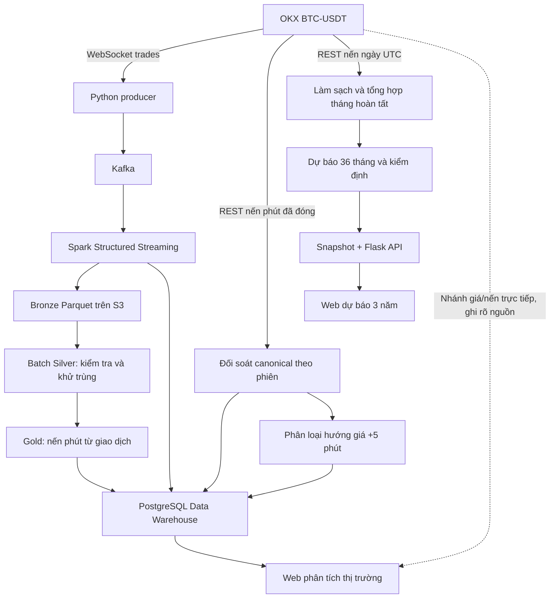

# Crypto Big Data — Phân tích BTC-USDT và dự báo 36 tháng

Đồ án xây dựng hệ thống thu thập, làm sạch, lưu trữ và trực quan hóa dữ liệu
BTC-USDT từ OKX, kết hợp dự báo giá đóng cửa từng tháng cho 3 năm tiếp theo.
Phân loại hướng giá sau 5 phút là nghiên cứu mở rộng, có dữ liệu và cách đánh giá riêng.

## Hai trang trong cùng ứng dụng

| Trang | URL khi chạy local | Nội dung |
|---|---|---|
| Dự báo 3 năm, trang mặc định | http://127.0.0.1:5001/du-bao-3-nam hoặc / | Lịch sử tháng, dự báo/backtest, baseline, sai số, bất định, CSV |
| Phân tích thị trường | http://127.0.0.1:5001/thi-truong | Nến, volume, dòng mua/bán, giao dịch lớn, dự báo +5 phút |

Biểu đồ tháng hỗ trợ lăn chuột để zoom, kéo ngang, preset Toàn bộ/5 năm lịch sử/
24 tháng gần đây + 36 tháng dự báo, tooltip, bàn phím và reset. Chỉ lịch sử có
OHLC thật; tương lai chỉ có dự báo close. Trạng thái từng chặng xử lý là khối thu
gọn chung. Futures giữ trong mục mở rộng, gập mặc định.
[Hướng dẫn giao diện và ảnh báo cáo](docs/RESEARCH_UI.md).

## Đáp ứng yêu cầu đồ án bằng bằng chứng

| Tiêu chí | Cách thực hiện | Tài liệu |
|---|---|---|
| Chọn dữ liệu | Dữ liệu kinh tế BTC-USDT Spot, đơn vị BTC/USDT, thời gian UTC | [Sườn báo cáo](docs/REPORT_OUTLINE.md) |
| Thu thập và dẫn nguồn | OKX REST ngày/phút và WebSocket trades; giữ nguồn, phiên và checksum | [Dữ liệu và làm sạch](docs/DATA_QUALITY_AUDIT.md) |
| Làm sạch | Kiểu dữ liệu, giá/size hữu hạn, trùng, OHLC, thiếu/đến trễ, nến đóng và REST canonical | [Khôi phục canonical](docs/CANONICAL_DATA_REPAIR.md) |
| Trực quan hóa | Hai trang có bộ lọc, chú giải, đơn vị, nguồn và thời điểm cập nhật | [Giao diện](docs/RESEARCH_UI.md) |
| Dự báo/đánh giá 3 năm | 36 close tháng, chia thời gian, rolling validation, holdout, baseline, dải bất định | [Dự báo dài hạn](docs/LONG_TERM_FORECAST.md) |

Mức điểm phụ thuộc rubric chi tiết, báo cáo, phân công và bảo vệ của nhóm.
Repo không cam kết dự báo chính xác hoặc lợi nhuận giao dịch.

## Kiến trúc đang sử dụng



Nhánh dài hạn độc lập với Kafka và bộ phân loại +5 phút. Nến trực tiếp hiển thị
được không tự chứng minh Kafka → Spark → S3 → DW đang chạy; dùng phép đo hệ thống.

## Cài đặt và chạy trên Windows

Cần Python 3.11, Docker Desktop và Java 8/11/17 phù hợp Spark 3.5.1.
Node.js 20 dùng cho kiểm thử JavaScript, không cần để phục vụ web.
Mở PowerShell tại thư mục repo:

```powershell
py -3.11 -m venv .venv
.venv/Scripts/python.exe -m pip install -r requirements.local.lock.txt
.venv/Scripts/python.exe scripts/research_artifacts.py restore
.venv/Scripts/python.exe scripts/research_artifacts.py verify
if (-not (Test-Path .env)) { Copy-Item configs/local.env.example .env }
notepad .env
```

Điền mật khẩu PostgreSQL local, AWS key của bạn, bucket và prefix riêng được cấp
quyền. Không đưa `.env` hoặc khóa vào Git/ảnh báo cáo. Không ghi đè `.env` đang dùng.

- `STORAGE_DESTINATION=s3`: dữ liệu vận hành ghi vào S3.
- `S3_RUN_PREFIX=crypto/local-runs/<ten-phien>`: không dùng prefix dữ liệu chung.
- `CANONICAL_SNAPSHOT_STORAGE=local`: đọc bản nghiên cứu đã khôi phục và kiểm
  checksum trên máy, độc lập với bucket vận hành. Không cần đổi URI nguồn trong
  descriptor hoặc giả lập dữ liệu. Mẫu `.env` đã chọn policy này.
- Với cấu hình cũ chưa có policy, mặc định `inherit` giữ nguyên cách chọn S3/local.
- Thiết lập `JAVA_HOME` nếu Java không được tìm thấy; xem mẫu cấu hình.

Mở Docker Desktop, sau đó:

```powershell
./scripts/Start-LocalDemo.ps1 -Streaming -Batch
# Dừng các tiến trình của ứng dụng, giữ container, dữ liệu và checkpoint:
./scripts/Stop-LocalDemo.ps1
```

Chờ web/DB ready và các phép đo mới. Streaming/batch cần làm nóng. Gói nghiên
cứu không sao chép DB live: bảng vận hành tích lũy theo thời gian thu thập; chức
năng cần ngữ cảnh mới sẽ báo thiếu/cũ khi chưa đủ dữ liệu. Không xóa volume hay
checkpoint để xử lý lỗi. Log/PID nằm trong `data/runtime/`.

[Hướng dẫn vận hành, khôi phục và phạm vi kiểm chứng](docs/LOCAL_DEMO_HANDOVER.md).
Các lệnh cài `requirements.txt` và launcher cũ trong lịch sử Git không thay thế
quick-start đã kiểm chứng ở trên.

## Gói nghiên cứu đi cùng mã nguồn

Repo chứa gói khoảng 11 MB tại `artifacts/research/academic-snapshot-20261109.zip`
kèm manifest SHA-256. Nó gồm dữ liệu canonical đã khóa, lịch sử ngày/tháng,
dự báo gốc, đánh giá ML và nghiên cứu dài hạn bổ sung. Không chứa `.env`, khóa,
raw stream toàn kho, venv hoặc DB live.

Lệnh `restore` kiểm archive, từng file và phiên bản code/model trước khi ghi;
không ghi đè kết quả local khác và không huấn luyện lại. Pointer active được
khôi phục cuối cùng và được Git ignore. Đây là snapshot cố định, không phải giá
thị trường hôm nay. [Nội dung và cách tái lập](artifacts/research/README.md).

Muốn làm thí nghiệm mới, tạo phiên mới bằng các script nghiên cứu và giữ riêng
kết quả cũ. Không thay dữ liệu rồi gắn nhãn là cùng snapshot đã công bố.

## Kết quả và giới hạn nghiên cứu

**Dài hạn gốc:** 3.223 nến ngày sạch, 105 tháng hoàn tất 02/2018–10/2026.
69 tháng chọn phương pháp, giữ riêng 36 tháng để test. Dự báo tương lai 11/2026–
10/2029. MAE test của phương pháp được chọn là 47.949,55 USDT so với baseline
43.678,28 USDT, cao hơn 9,78%. Dải 95% rất rộng; độ phủ không phải accuracy.

**Nghiên cứu dài hạn bổ sung:** baseline + Ridge cải thiện MAE trên 3 mốc hồi cứu,
nhưng cửa sổ chồng lấn và outcome đã được xem; không coi là ba test độc lập mới.
Khi chọn trên toàn bộ 105 tháng, validation của policy nghiên cứu chọn baseline.
Kết quả gốc và bổ sung được giữ riêng, không đổi mô hình theo cột test.

**Ngắn hạn:** 154.351 nến REST đã khóa; 17.274 mẫu primary test. Logistic nghiên
cứu đạt accuracy 51,42%, balanced accuracy 51,36%; XGBoost v2.0.0 đang dùng đạt
51,32% và 51,16% trên cùng tập. CI chênh lệch chứa 0, thắng baseline tốt nhất ở
2/4 fold, nên chưa thay model đang chạy. Không dùng accuracy +5 phút để đánh giá
bài toán 3 năm. [Protocol và đánh giá](docs/SHORT_TERM_ML_EVALUATION.md).

## Kiểm thử

Bộ offline không cần khóa AWS, PostgreSQL, Kafka hoặc Java đang chạy:

```powershell
.venv/Scripts/python.exe scripts/check_project.py
```

Runner chạy unit/hồi quy đã phân nhóm, kiểm JS, restore/verify gói nghiên cứu và
kiểm chứng ML đã khóa. CI thực hiện trên Windows và Linux. Không dùng `discover`
toàn bộ thư mục để thay cho runner vì repo còn các bài tích hợp cần dịch vụ riêng.

Các bài cần hạ tầng, chạy có chủ đích:

```powershell
# DB test riêng, không dùng DB live để làm fixture:
.venv/Scripts/python.exe scripts/run_legacy_regressions.py
# API thị trường với dịch vụ thật:
.venv/Scripts/python.exe tests/test_web_ui_refactor.py
# Smoke giới hạn thời gian, không chạy khi import:
.venv/Scripts/python.exe tests/test_kafka_consumer.py --seconds 30
.venv/Scripts/python.exe tests/test_spark_streaming.py --seconds 30
# Luồng thật, không suy luận từ việc nến trực tiếp hiển thị:
.venv/Scripts/python.exe scripts/audit_demo_pipeline.py
```

S3 integration test dùng `crypto/tests/<suite>/<run-id>/`, không dọn prefix dữ
liệu dùng chung. Xem [S3 test isolation](docs/S3_TEST_ISOLATION.md),
[DB regression](docs/LEGACY_REGRESSION_REPAIR.md) và
[API nến có dự phòng](docs/CANDLES_API_RELIABILITY.md).

Các số đo tải/phục hồi 09/11 là bằng chứng lịch sử có phạm vi riêng, không phải
chứng nhận mọi môi trường hoặc khả năng chạy công nghiệp nhiều ngày.

## Báo cáo và bàn giao

- [Sườn báo cáo để duyệt trước khi viết từng mục](docs/REPORT_OUTLINE.md).
- [Hướng dẫn nội dung báo cáo](docs/REPORT_GUIDE.md).
- [Thống kê làm sạch](docs/DATA_QUALITY_AUDIT.md).
- [Giao diện và chọn ảnh minh chứng](docs/RESEARCH_UI.md).

Đóng gói mã nguồn hiện tại và gói nghiên cứu, có thể thêm thư mục ảnh/log thật:

```powershell
.venv/Scripts/python.exe scripts/export_demo_handover.py
# Hoặc chỉ định nơi xuất và bằng chứng có sẵn:
# ... --output-dir data/exports/handover --evidence-dir <thu-muc-anh-va-bao-cao>
```

Exporter không tự gán số test hay dùng đường dẫn máy tác giả. Gói có manifest
của từng file; các bằng chứng được cung cấp giữ nguyên ngày và phạm vi đo.
