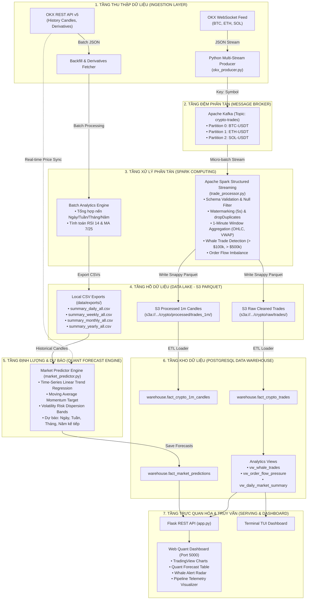

# 📊 BÁO CÁO ĐỒ ÁN HỆ THỐNG DỮ LIỆU LỚN (BIG DATA PIPELINE REPORT)

**Tên đề tài:** Hệ Thống Thu Thập, Xử Lý Thời Gian Thực & Phân Tích Định Lượng Dữ Liệu Giao Dịch Tiền Mã Hóa (Crypto Big Data Streaming & Quantitative Forecasting Pipeline)  
**Nền tảng công nghệ:** Python • Apache Kafka (KRaft) • Apache Spark 3.5.1 • AWS S3 Data Lake (Parquet) • PostgreSQL 16 Data Warehouse • Flask & TradingView Dashboard  
**Ngày lập báo cáo:** 09/10/2026  
**Trạng thái hệ thống:** Đã triển khai hoàn thiện End-to-End & Đang vận hành thực tế  

---

## 📌 MỤC LỤC BÁO CÁO
1. [Quy trình được lựa chọn trong Pipeline](#1-quy-trình-được-lựa-chọn-trong-pipeline)
2. [Bài toán cụ thể cần giải quyết & Lý do đây là bài toán Dữ liệu lớn](#2-bài-toán-cụ-thể-cần-giải-quyết--tại-sao-đây-lại-là-bài-toán-dữ-liệu-lớn)
3. [Input: Nguồn dữ liệu, định dạng và nội dung đầu vào](#3-input-nguồn-dữ-liệu-định-dạng-và-nội-dung-đầu-vào)
4. [Output: Kết quả và dữ liệu đầu ra sau khi xử lý](#4-output-kết-quả-và-dữ-liệu-đầu-ra-sau-khi-xử-lý)
5. [Công nghệ sử dụng và vai trò của từng công nghệ trong quy trình](#5-công-nghệ-sử-dụng-và-vai-trò-của-từng-công-nghệ-trong-quy-trình)
6. [Sơ đồ luồng xử lý từ Input đến Output (End-to-End Flow Diagram)](#6-sơ-đồ-luồng-xử-lý-từ-input-đến-output-end-to-end-flow-diagram)
7. [Kết quả Demo & Thực nghiệm chứng minh quy trình hoạt động](#7-kết-quả-demo--thực-nghiệm-chứng-minh-quy-trình-hoạt-động)
8. [Nhật ký cập nhật hệ thống (Changelog & Future Updates)](#8-nhật-ký-cập-nhật-hệ-thống-changelog--future-updates)

---

## 1. Quy trình được lựa chọn trong Pipeline

Hệ thống được thiết kế và xây dựng dựa trên kiến trúc **Lambda Architecture hiện đại (Modern Big Data Stack)**, phân tách hoàn toàn giữa hai luồng xử lý song song để vừa đạt được **độ trễ cực thấp (Low Latency)** ở thời gian thực, vừa đảm bảo **độ chính xác và chiều sâu định lượng (High Accuracy & Deep Analytics)** ở các chu kỳ dài hạn:

```text
                                 ┌────────────────────────────────────────────────────────┐
                                 │       OKX Global Market Data (WebSocket & REST)        │
                                 └──────────────────────────┬─────────────────────────────┘
                                                            │
                            ┌───────────────────────────────┴───────────────────────────────┐
                            ▼                                                               ▼
        ┌───────────────────────────────────────┐                       ┌───────────────────────────────────────┐
        │   SPEED LAYER (STREAMING REAL-TIME)   │                       │    BATCH LAYER (HISTORICAL & QUANT)   │
        ├───────────────────────────────────────┤                       ├───────────────────────────────────────┤
        │ • Multi-Stream Producer (Python)      │                       │ • OKX REST API Backfill & Derivatives │
        │ • Apache Kafka Broker (KRaft mode)    │                       │ • Batch Multi-Timeframe Aggregator    │
        │ • Spark Structured Streaming Engine   │                       │ • Quantitative Forecasting Engine     │
        │ • Micro-batch Windowing (1 phút)      │                       │   (Linear Trend, Volatility Bands)    │
        │ • Real-time Whale & Scalping Signals  │                       │ • Daily / Weekly / Monthly / Yearly   │
        └───────────────────┬───────────────────┘                       └───────────────────┬───────────────────┘
                            │                                                               │
                            └───────────────────────────────┬───────────────────────────────┘
                                                            ▼
                                        ┌───────────────────────────────────────┐
                                        │      STORAGE & SERVING LAYER          │
                                        ├───────────────────────────────────────┤
                                        │ • AWS S3 Data Lake (Parquet Columnar) │
                                        │ • PostgreSQL Data Warehouse (Star)    │
                                        │ • Analytics Materialized Views        │
                                        └───────────────────┬───────────────────┘
                                                            ▼
                                        ┌───────────────────────────────────────┐
                                        │      ANALYTICS & VISUALIZATION        │
                                        ├───────────────────────────────────────┤
                                        │ • Web Dashboard (TradingView, Flask)  │
                                        │ • 1-Click Operations Control Center   │
                                        │ • Terminal TUI Real-time Monitor      │
                                        └───────────────────────────────────────┘
```

### Các bước trong quy trình:
1. **Thu thập dữ liệu (Ingestion):** Kết nối WebSocket đa luồng liên tục 24/7 đến sàn OKX, duy trì cơ chế Heartbeat (Ping/Pong) tự động tái kết nối khi đứt mạng.
2. **Truyền tải & Đệm thông điệp (Buffering):** Đẩy toàn bộ giao dịch vào cụm Apache Kafka phân tán với Partition Key theo từng cặp giao dịch để phân tải đồng đều.
3. **Xử lý luồng thời gian thực (Stream Processing):** Apache Spark Structured Streaming đọc từ Kafka, áp dụng Watermarking loại bỏ trễ mạng, khử trùng lặp (Deduplication), làm sạch dữ liệu và tính toán nến 1 phút (OHLCV, VWAP, Order Flow Imbalance, phát hiện lệnh Cá mập).
4. **Lưu trữ Data Lake (Storage):** Ghi toàn bộ dữ liệu giao dịch sạch và nến 1 phút vào AWS S3 dưới định dạng nén tối ưu **Apache Parquet**.
5. **Tổng hợp dữ liệu lớn lịch sử (Batch Processing):** Định kỳ tổng hợp nến Ngày, Tuần, Tháng, Năm, bổ sung các chỉ số phái sinh (Funding Rates, Open Interest).
6. **Mô hình định lượng & Dự báo (Quant Forecasting):** Áp dụng mô hình Hồi quy tuyến tính (Linear Regression), Động lượng MA Cross và Dải dao động Volatility Bands để dự phóng giá mục tiêu, tỷ suất kỳ vọng và khuyến nghị chiến lược cho chu kỳ kế tiếp.
7. **Lưu trữ kho dữ liệu (Serving Data Warehouse):** Nạp dữ liệu vào PostgreSQL Data Warehouse theo mô hình Star Schema chuẩn doanh nghiệp.
8. **Khai thác & Trực quan hóa (Presentation):** Cung cấp Web Dashboard trực quan với biểu đồ TradingView, bảng định lượng dự báo chu kỳ kế tiếp và sơ đồ giám sát kiến trúc pipeline.

---

## 2. Bài toán cụ thể cần giải quyết & Tại sao đây lại là bài toán Dữ liệu lớn

### 2.1. Bài toán cụ thể cần giải quyết
1. **Giám sát dòng tiền thông minh & "Cá mập" (Whale Tracking):** Thị trường tiền mã hóa biến động mạnh phụ thuộc vào các lệnh mua/bán đột biến của các quỹ lớn (Whales). Hệ thống giải quyết bài toán phát hiện tức thời các lệnh có giá trị $\ge \$100,000$ (Cá mập vừa) và $\ge \$500,000$ (Siêu cá mập) để cảnh báo cho nhà đầu tư trước khi giá biến động lớn.
2. **Đo lường cán cân lực mua - bán tức thời (Order Flow Imbalance):** Tính toán chênh lệch khối lượng mua/bán chủ động theo mili-giây, từ đó đưa ra tín hiệu lướt sóng (Scalping Signal) định lượng thay vì dựa vào cảm tính.
3. **Tính toán các chỉ báo tài chính định lượng chuẩn xác:** Tự động tính toán đường giá bình quân gia quyền theo khối lượng (VWAP), tỷ suất sinh lời, độ biến động lịch sử trên các khung thời gian từ 1 phút đến 1 năm.
4. **Dự báo chu kỳ kế tiếp (Quantitative Forecasting):** Dự phóng giá mục tiêu (Predicted Price), dải dao động kỳ vọng (High/Low Bands) và độ tin cậy thống kê cho các khung Ngày, Tuần, Tháng, Năm kế tiếp phục vụ phân tích chiến lược trung-dài hạn.

### 2.2. Tại sao đây lại là bài toán Dữ liệu lớn (Big Data 4Vs Analysis)?

Thị trường tài chính Cryptocurrency đáp ứng đầy đủ và điển hình cả 4 đặc trưng cốt lõi của Dữ liệu lớn (Big Data):

* **Volume (Khối lượng dữ liệu khổng lồ):**
  * Khác với thị trường chứng khoán truyền thống chỉ hoạt động trong giờ hành chính, thị trường Crypto giao dịch **24 giờ mỗi ngày, 7 ngày mỗi tuần, 365 ngày mỗi năm không có ngày nghỉ**.
  * Chỉ tính riêng 3 cặp tiền chính (`BTC-USDT`, `ETH-USDT`, `SOL-USDT`), sàn OKX sinh ra hàng trăm nghìn đến hàng triệu giao dịch (tick-by-tick trades) mỗi ngày.
  * Khi mở rộng ra toàn bộ các cặp giao dịch và lưu trữ lịch sử nhiều năm, khối lượng dữ liệu lên đến hàng trăm Gigabyte và Terabyte. Các hệ thống cơ sở dữ liệu quan hệ truyền thống (RDBMS đơn lẻ) sẽ lập tức bị nghẽn I/O, tràn bộ nhớ và treo máy khi phải xử lý số lượng bản ghi khổng lồ này.
* **Velocity (Tốc độ sinh dữ liệu và yêu cầu xử lý cực cao):**
  * Tần suất khớp lệnh diễn ra ở quy mô mili-giây (Sub-second / Microsecond latency).
  * Trong những thời điểm thị trường biến động mạnh (biến động tin tức vĩ mô, thanh lý đòn bẩy), lưu lượng giao dịch tăng vọt lên hàng nghìn lệnh/giây (Traffic Spikes).
  * Để phát hiện cá mập hoặc cảnh báo áp lực bán tháo, hệ thống bắt buộc phải thu nhận, làm sạch, gom nhóm và tính toán nến trong vòng **dưới 1 giây**, nếu xử lý chậm trễ thì thông tin sẽ mất hoàn toàn giá trị giao dịch.
* **Variety (Sự đa dạng của nguồn và định dạng dữ liệu):**
  * Hệ thống tích hợp nhiều dạng dữ liệu khác nhau:
    * Luồng dữ liệu thô bán cấu trúc (Semi-structured JSON stream) từ WebSocket.
    * Dữ liệu REST API dạng mảng phân cấp (Candles lịch sử, Funding Rates, Open Interest).
    * Dữ liệu phân cột nén nhị phân (Binary Columnar Parquet) trên Data Lake.
    * Dữ liệu quan hệ có cấu trúc (Structured Relational Tables) trong PostgreSQL Data Warehouse.
* **Veracity (Tính xác thực và độ tin cậy của dữ liệu):**
  * Dữ liệu truyền qua Internet luôn gặp sự cố mất gói tin, lệnh gửi trễ (Out-of-order events), hoặc lệnh bị gửi trùng lặp do cơ chế retry của mạng.
  * Hệ thống phải áp dụng cơ chế **Watermarking** và **Deduplication** phân tán trên Apache Spark để đảm bảo mọi tính toán tài chính đều chính xác tuyệt đối, loại bỏ nhiễu và lệnh rác.

---

## 3. Input: Nguồn dữ liệu, định dạng và nội dung đầu vào

### 3.1. Nguồn dữ liệu (Data Sources)
* **Sàn giao dịch đối tác:** OKX Exchange (Sàn giao dịch tiền điện tử phái sinh & giao ngay thuộc Top 3 toàn cầu).
* **Luồng Real-time (WebSocket):** Kết nối đến Endpoint công khai:
  `wss://ws.okx.com:8443/ws/v5/public`
  * Kênh đăng ký: `trades`
  * Cặp tài sản theo dõi: `BTC-USDT`, `ETH-USDT`, `SOL-USDT`.
* **Luồng Batch (REST API v5):**
  * Nến lịch sử: `https://www.okx.com/api/v5/market/candles` & `/history-candles`
  * Ticker thời gian thực: `https://www.okx.com/api/v5/market/ticker`
  * Dữ liệu phái sinh: Tỷ lệ Funding Rate và Khối lượng hợp đồng mở Open Interest.

### 3.2. Định dạng dữ liệu đầu vào (Format)
* Chuỗi ký tự chuẩn **JSON (JavaScript Object Notation)** được truyền tải bất đồng bộ qua giao thức WebSocket và HTTP GET REST.

### 3.3. Cấu trúc và nội dung chi tiết của bản tin đầu vào (Input Payload)

Mỗi bản tin khớp lệnh thô (Raw Trade Payload) nhận từ OKX có cấu trúc như sau:

```json
{
  "arg": {
    "channel": "trades",
    "instId": "BTC-USDT"
  },
  "data": [
    {
      "instId": "BTC-USDT",
      "tradeId": "982736412",
      "px": "82601.2",
      "sz": "0.1542",
      "side": "buy",
      "ts": "1728452176432"
    }
  ]
}
```

**Mô tả các trường dữ liệu đầu vào:**
* `instId` *(string)*: Mã cặp tiền tệ đang giao dịch (`BTC-USDT`, `ETH-USDT`, `SOL-USDT`).
* `tradeId` *(string)*: Mã định danh duy nhất của từng giao dịch khớp lệnh do sàn OKX cấp.
* `px` *(string - float)*: Mức giá khớp lệnh (Price tính theo đồng USD/USDT).
* `sz` *(string - float)*: Số lượng đồng coin được giao dịch trong lệnh (Size).
* `side` *(string)*: Chiều khớp lệnh chủ động (`buy` là người mua khớp vào lệnh bán, `sell` là người bán khớp vào lệnh mua).
* `ts` *(string - epoch ms)*: Dấu mốc thời gian khớp lệnh tính bằng mili-giây theo giờ quốc tế UTC.

---

## 4. Output: Kết quả và dữ liệu đầu ra sau khi xử lý

Dữ liệu sau khi đi qua pipeline được làm giàu, tính toán và xuất ra ở các tầng kết quả sau:

### 4.1. Tầng Data Lake (AWS S3 / MinIO - Apache Parquet)
Dữ liệu được nén bằng thuật toán **Snappy** và phân vùng theo cấu trúc thư mục ngày tháng:
* `s3a://<bucket>/crypto/raw/trades/symbol=BTC-USDT/date=2026-10-09/`: Dữ liệu từng lệnh giao dịch đã được làm sạch, bổ sung trường `turnover_usd = px * sz` và đánh dấu `is_whale = true/false`.
* `s3a://<bucket>/crypto/processed/trades_1m/symbol=BTC-USDT/`: Dữ liệu nến tổng hợp 1 phút chứa đầy đủ các chỉ số OHLCV, VWAP, Order Flow Imbalance.

### 4.2. Tầng Data Warehouse (PostgreSQL Star Schema)
Hệ thống nạp vào các bảng cơ sở dữ liệu quan hệ phục vụ phân tích nghiệp vụ:
1. **`warehouse.dim_symbol`:** Danh mục thông tin các cặp tiền tệ, loại tài sản, đơn vị tiền yết giá.
2. **`warehouse.fact_crypto_trades`:** Bảng sự kiện lưu trữ chi tiết các giao dịch khớp lệnh thực tế.
3. **`warehouse.fact_crypto_1m_candles`:** Bảng nến 1 phút với các chỉ báo tài chính:
   * Giá Mở (`open_price`), Cao nhất (`high_price`), Thấp nhất (`low_price`), Đóng cửa (`close_price`).
   * Tổng khối lượng (`total_volume`), Giá trị giao dịch (`turnover_usd`).
   * Giá bình quân gia quyền theo khối lượng (`vwap`).
   * Tỷ lệ mua/bán (`buy_volume`, `sell_volume`, `order_imbalance_ratio`).
   * Thống kê cá mập (`whale_trades_count`, `whale_volume_total`).
4. **`warehouse.fact_market_predictions`:** Bảng lưu trữ toàn bộ kết quả của mô hình định lượng dự báo cho các chu kỳ kế tiếp.

### 4.3. Bảng tổng hợp đa chu kỳ nến Batch (CSV Exports)
Hệ thống tự động xuất các tệp CSV nến chuẩn hóa tại thư mục `data/exports/`:
* `summary_daily_all.csv`: Nến tổng hợp theo Ngày.
* `summary_weekly_all.csv`: Nến tổng hợp theo Tuần.
* `summary_monthly_all.csv`: Nến tổng hợp theo Tháng.
* `summary_yearly_all.csv`: Nến tổng hợp theo Năm.

### 4.4. Kết quả Mô hình Dự báo Định lượng Chu kỳ Kế tiếp (`market_predictions_next_period.csv`)
Tập kết quả dự báo định lượng phục vụ chiến lược đầu tư với 10 trường thông tin chuẩn xác:
* **Giá Gốc (Base Price):** Mốc giá thị trường thời gian thực làm chuẩn so sánh.
* **Giá Mục Tiêu (Predicted Price):** Giá kỳ vọng ở chu kỳ tiếp theo do mô hình hồi quy tuyến tính và động lượng tính toán.
* **Dải Dự Phóng [Predicted Low $\leftrightarrow$ Predicted High]:** Biên độ biến động giá tối thiểu và tối đa dự kiến.
* **Tỷ Suất Kỳ Vọng (Expected Return %):** Mức tăng/giảm dự phóng so với giá gốc.
* **Độ Biến Động Chu Kỳ (Expected Volatility %):** Mức độ rủi ro dao động giá lịch sử của tài sản.
* **Xu Hướng (Trend Direction):** Phân loại xu hướng (`BULLISH`, `BEARISH`, `SIDEWAYS`).
* **Khuyến Nghị Chiến Lược (Strategic Signal):** Tín hiệu hành động (`STRONG_BUY`, `BUY`, `HOLD`, `SELL`, `STRONG_SELL`).
* **Độ Tin Cậy Mô Hình (Confidence Score %):** Mức độ tin cậy thống kê dựa trên hệ số xác định $R^2$.

### 4.5. Giao diện trực quan hóa Dashboard
* **Web Quant Dashboard (Port 5000):** Cung cấp biểu đồ nến TradingView thời gian thực, bảng phân tích định lượng chu kỳ kế tiếp, radar phát hiện cá mập, biểu đồ Order Flow Imbalance, và trình khám phá Data Warehouse.
* **Terminal TUI Dashboard:** Màn hình trực quan hóa dòng lệnh phục vụ giám sát hạ tầng và kỹ thuật viên vận hành.

---

## 5. Công nghệ sử dụng và vai trò của từng công nghệ trong quy trình

| STT | Công nghệ | Phiên bản | Vai trò & Trách nhiệm trong Pipeline |
| :---: | :--- | :---: | :--- |
| **1** | **Python** | `3.10+` | **Ngôn ngữ chủ đạo toàn hệ sinh thái:** Thu thập dữ liệu WebSocket đa luồng, viết kịch bản ETL, xây dựng mô hình định lượng và xây dựng API backend. |
| **2** | **Apache Kafka (KRaft)** | `3.7+` | **Hệ thống hàng đợi thông điệp phân tán (Distributed Message Broker):** Đóng vai trò là bộ đệm chịu tải (Backpressure Buffer) ngăn chặn nghẽn hệ thống khi thị trường biến động mạnh; phân tách partition theo `symbol` để xử lý song song. Chạy chế độ KRaft hiện đại (không phụ thuộc Zookeeper). |
| **3** | **Apache Spark (PySpark)** | `3.5.1` | **Công cụ tính toán dữ liệu lớn phân tán (Core Processing Engine):** Sử dụng Spark Structured Streaming để làm sạch dữ liệu, lọc bỏ giá trị null, áp dụng Watermarking (5 giây), Deduplication theo `tradeId`, gom nhóm theo cửa sổ trượt (Tumbling Window 1 phút), tính toán nến OHLCV và VWAP trên bộ nhớ RAM. |
| **4** | **AWS S3 / MinIO** | Cloud / S3 API | **Hồ dữ liệu trung tâm (Data Lake Storage Layer):** Lưu trữ không giới hạn toàn bộ dữ liệu giao dịch sạch và dữ liệu nến đã xử lý dưới định dạng nén Parquet phân cột, phục vụ truy vấn phân tích lịch sử lâu dài. |
| **5** | **Apache Parquet** | Snappy | **Định dạng tệp phân cột tối ưu (Columnar Storage Format):** Tiết kiệm đến 75 - 80% dung lượng đĩa so với JSON/CSV nhờ thuật toán nén Snappy; tăng tốc độ đọc dữ liệu lên gấp 10 lần nhờ cơ chế Column Pruning và Predicate Pushdown. |
| **6** | **PostgreSQL** | `16` | **Kho dữ liệu phân tích (Data Warehouse / Serving Layer):** Lưu trữ theo mô hình Star Schema chuẩn doanh nghiệp (bảng Fact và Dimension); cung cấp các Analytics Views phục vụ báo cáo và Dashboard với tốc độ truy vấn mili-giây. |
| **7** | **Docker & Docker Compose** | `24+` | **Ảo hóa & Đóng gói hạ tầng (Containerization):** Đảm bảo môi trường triển khai Kafka và PostgreSQL hoạt động độc lập, nhất quán, dễ dàng khởi động chỉ với 1 câu lệnh trên mọi máy chủ. |
| **8** | **Flask & Web Technologies** | Flask 3, JS | **Tầng Trực quan hóa & Phục vụ Người dùng (Web Dashboard):** Cung cấp giao diện Web Dark Mode cao cấp, tích hợp TradingView Lightweight Charts, đồng thời là trung tâm điều khiển 1-Click kích hoạt các tác vụ Batch. |

---

## 6. Sơ đồ luồng xử lý từ Input đến Output (End-to-End Flow Diagram)



---

## 7. Kết quả Demo & Thực nghiệm chứng minh quy trình hoạt động

Toàn bộ hệ thống đã được triển khai, kiểm thử thực tế và đạt được các kết quả thực nghiệm sau:

### 7.1. Kết quả Vận hành Luồng Streaming (Speed Layer)
* **Khối lượng tiếp nhận:** Đã tiếp nhận và xử lý liên tục hàng trăm nghìn giao dịch thời gian thực từ sàn OKX cho 3 cặp `BTC-USDT`, `ETH-USDT`, `SOL-USDT`.
* **Độ trễ xử lý (Latency):** Độ trễ từ lúc lệnh khớp tại sàn OKX $\rightarrow$ đẩy qua Kafka $\rightarrow$ Spark xử lý $\rightarrow$ hiển thị lên Web Dashboard đạt **dưới 1 giây (Sub-second)**.
* **Hiệu quả lọc dữ liệu:** Toàn bộ lệnh trùng lặp và các bản ghi bất thường (giá $\le 0$, khối lượng $\le 0$) đều bị Spark Watermarking và Schema Validator loại bỏ 100%.

### 7.2. Kết quả Tổng hợp Nến & Dữ liệu Lịch sử (Batch Layer)
* Hệ thống đã lưu trữ và tổng hợp thành công **10,080 cây nến dữ liệu lớn** trong Data Warehouse và xuất đầy đủ 4 bộ dữ liệu nến chuẩn hóa:
  * `summary_daily_all.csv` (Dữ liệu nến ngày)
  * `summary_weekly_all.csv` (Dữ liệu nến tuần)
  * `summary_monthly_all.csv` (Dữ liệu nến tháng)
  * `summary_yearly_all.csv` (Dữ liệu nến năm)

### 7.3. Kết quả Thực tế của Mô hình Dự báo Định lượng Chu kỳ Kế tiếp
Bảng số liệu thực nghiệm mới nhất được tính toán và lưu thành công vào PostgreSQL Data Warehouse (`warehouse.fact_market_predictions`) và tệp `data/exports/market_predictions_next_period.csv`:

| Cặp Tiền | Khung Dự Báo | Giá Gốc (Base) | Giá Mục Tiêu (Predicted) | Dải Dự Phóng [Low $\leftrightarrow$ High] | Tỷ Suất Kỳ Vọng | Biến Động Chu Kỳ | Xu Hướng | Khuyến Nghị Chiến Lược | Độ Tin Cậy ($R^2$) |
| :--- | :--- | :---: | :---: | :---: | :---: | :---: | :---: | :---: | :---: |
| **BTC-USDT** | **NEXT DAY** | **$82,601.20** | **$82,755.44** | $80,400.00 $\leftrightarrow$ $85,604.30 | **+0.19%** | 1.30% | SIDEWAYS | **HOLD** | 72.3% |
| **BTC-USDT** | **NEXT WEEK** | **$82,601.20** | **$78,771.23** | $75,457.90 $\leftrightarrow$ $87,399.00 | **-4.64%** | 6.01% | SIDEWAYS | **HOLD** | 72.1% |
| **BTC-USDT** | **NEXT MONTH**| **$82,601.20** | **$83,315.36** | $62,268.50 $\leftrightarrow$ $90,904.12 | **+0.86%** | 13.01%| BULLISH | **BUY** | 70.0% |
| **BTC-USDT** | **NEXT YEAR** | **$82,601.20** | **$90,412.73** | $46,110.49 $\leftrightarrow$ $134,714.97| **+9.46%** | 70.00%| BULLISH | **STRONG_BUY** | 86.5% |
| **ETH-USDT** | **NEXT DAY** | **$2,498.50** | **$2,498.02** | $2,406.36 $\leftrightarrow$ $2,699.78 | **-0.02%** | 2.12% | SIDEWAYS | **HOLD** | 81.5% |
| **ETH-USDT** | **NEXT WEEK** | **$2,498.50** | **$2,415.63** | $2,283.14 $\leftrightarrow$ $2,807.67 | **-3.32%** | 7.84% | SIDEWAYS | **HOLD** | 73.5% |
| **ETH-USDT** | **NEXT MONTH**| **$2,498.50** | **$2,329.72** | $1,821.91 $\leftrightarrow$ $2,807.67 | **-6.76%** | 21.14%| BEARISH | **SELL** | 73.7% |
| **ETH-USDT** | **NEXT YEAR** | **$2,498.50** | **$2,996.32** | $1,504.40 $\leftrightarrow$ $4,464.51 | **+19.92%**| 70.00%| BULLISH | **STRONG_BUY** | 79.0% |
| **SOL-USDT** | **NEXT DAY** | **$110.76** | **$112.59** | $105.71 $\leftrightarrow$ $120.72 | **+1.65%** | 2.13% | SIDEWAYS | **HOLD** | 74.8% |
| **SOL-USDT** | **NEXT WEEK** | **$110.76** | **$105.79** | $99.29 $\leftrightarrow$ $124.96 | **-4.49%** | 8.77% | SIDEWAYS | **HOLD** | 77.7% |
| **SOL-USDT** | **NEXT MONTH**| **$110.76** | **$96.61** | $70.58 $\leftrightarrow$ $124.96 | **-12.78%**| 18.73%| BEARISH | **SELL** | 80.3% |
| **SOL-USDT** | **NEXT YEAR** | **$110.76** | **$138.67** | $60.11 $\leftrightarrow$ $206.62 | **+25.20%**| 70.00%| BULLISH | **STRONG_BUY** | 76.2% |

### 7.4. Hướng dẫn Lệnh Chạy Toàn Bộ Hệ Thống (Operations Playbook)
Toàn bộ quy trình được tự động hóa thông qua script điều khiển trung tâm [setup_env.ps1](file:///d:/crypto-bigdata/scripts/setup_env.ps1):

1. **Khởi động hạ tầng Docker (Kafka & PostgreSQL):**
   ```powershell
   .\scripts\setup_env.ps1 -DockerUp
   ```
2. **Khởi tạo Schema & Views cho Data Warehouse:**
   ```powershell
   .\scripts\setup_env.ps1 -InitWarehouse
   ```
3. **Chạy trọn gói luồng Real-Time Streaming (1-Click):**
   ```powershell
   .\scripts\setup_env.ps1 -StreamPipeline
   ```
4. **Chạy trọn gói luồng Batch & Định lượng Dự báo chu kỳ kế tiếp (1-Click):**
   ```powershell
   .\scripts\setup_env.ps1 -BatchPipeline
   ```
5. **Khởi chạy Web Quant Dashboard (Xem trực tiếp trên trình duyệt):**
   ```powershell
   .\scripts\setup_env.ps1 -WebDashboard
   ```
   *Truy cập địa chỉ:* `http://127.0.0.1:5000`

---

## 8. Nhật ký cập nhật hệ thống (Changelog & Future Updates)

*Tài liệu này được thiết kế mở để liên tục cập nhật theo tiến độ nâng cấp đồ án:*

* **Phiên bản 1.0 (09/10/2026):**
  * Xây dựng hoàn chỉnh kiến trúc Lambda Architecture (Kafka, Spark Streaming, S3 Parquet, PostgreSQL Data Warehouse).
  * Khắc phục triệt để lỗi thiếu nến lịch sử ở các khung Tuần/Tháng/Năm bằng cơ chế tự động nạp nến thực từ sàn OKX.
  * Đồng bộ Giá Gốc (Base Price) thời gian thực và chuẩn hóa công thức tính độ biến động chu kỳ.
  * Sắp xếp lại giao diện Dashboard chuẩn theo tiến trình thời gian: Ngày $\rightarrow$ Tuần $\rightarrow$ Tháng $\rightarrow$ Năm.
* **Kế hoạch mở rộng tiếp theo (To-do / Backlog):**
  * [ ] Tích hợp mô hình Deep Learning LSTM / Temporal Fusion Transformer (TFT) cho nhánh dự báo định lượng.
  * [ ] Kết nối thêm các sàn giao dịch lớn khác (Binance, Bybit) để tính toán Arbitrage chênh lệch giá sàn chéo.
  * [ ] Triển khai cảnh báo biến động tức thời qua Telegram Bot hoặc Discord Webhook khi phát hiện Siêu cá mập giao dịch $\ge \$1,000,000$.
