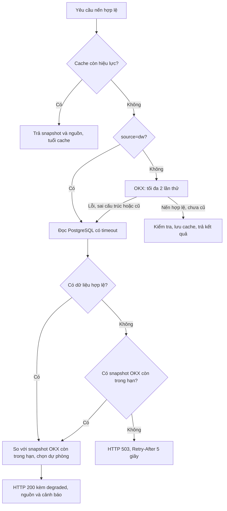

# API nến: giới hạn chờ, cache và dữ liệu dự phòng

Kiểm thử ngày 08/11/2026; hoàn tất bàn giao ngày 09/11/2026. Phạm vi:
`/api/candles`, truy vấn DW phục vụ nến và
nhãn nguồn/độ mới trên dashboard. Đây là kiểm chứng cho API nến, không phải
kết luận toàn bộ hệ thống hoặc chất lượng mô hình đã hoàn thiện.

## 1. Vấn đề đã xác nhận và cách sửa

| Vấn đề | Thay đổi |
|---|---|
| Một lần HTTP 503/33 request trong đợt audit trước; chưa xác định được căn nguyên chính xác của lần đó | Có timeout, retry giới hạn, log mã nguyên nhân và đường dự phòng; không quy lỗi lịch sử cho OKX khi thiếu log |
| Đo bản cũ trong lượt này: DW nến giờ/ngày HTTP 500 | Query tham chiếu `buy_volume`, `sell_volume` không có trong view. Lấy tổng từ fact trong cùng khoảng, giữ NULL khi nguồn không có số liệu |
| Hỏng kết nối OKX làm mất toàn bộ kết quả nến | Dùng dữ liệu PostgreSQL hoặc snapshot OKX trong cache nếu còn dùng được; báo rõ nguồn và độ mới |
| Các request đồng thời lặp lại cùng một truy vấn | Cache có giới hạn và gom request cùng khóa thành một lượt tải |
| Thiếu doanh số nhưng API tự lấy volume × close; thiếu confirm bị coi là đóng | Giữ doanh số/VWAP NULL khi thiếu; yêu cầu confirm hợp lệ từ OKX |
| Nến giờ/ngày DW mặc định đã đóng dù thiếu phút | Đếm phút thực có; chỉ đánh dấu đóng khi đủ 60/1.440 phút, tất cả đã đóng và khoảng đã kết thúc |
| Đổi khung nhanh hoặc polling chồng nhau | Không gửi thêm poll nến cùng khung khi request đang chạy; bỏ kết quả của khung cũ |

Không sửa dữ liệu thật để làm test qua, không tạo nến giả để lấp khoảng thiếu.
Các bảng, trọng số model và dự báo không được API này ghi/cập nhật.

## 2. Chính sách vận hành



- Timeout socket mỗi lần tối đa **1,25 giây**; tối đa **2 lần thử**, nghỉ tối đa
  **0,15 giây** giữa hai lần. Chỉ retry lỗi mạng và HTTP 408/429/500/502/503/504.
  HTTP 400, JSON sai, nến sai cấu trúc không được retry vô hạn.
- Caller chờ transport tối đa **3,2 giây**. Tối đa **4 worker** HTTP mỗi process,
  không xếp hàng HTTP vô hạn. DNS/socket bị kẹt không thể bị urllib hủy cưỡng bức;
  worker đang kẹt vẫn giữ slot cho tới khi kết thúc. Khi hết slot, chuyển dự phòng.
- DB: connect timeout **1 giây**, statement timeout **1,5 giây**, lock timeout
  **0,5 giây**, timezone UTC và transaction mặc định **read-only**. Thời gian DB
  nằm sau thời gian OKX; 3,2 giây không phải cam kết tổng thời gian endpoint.
- Request cùng khóa đang chạy được chờ tối đa 7,5 giây rồi trả bận nếu chưa xong.
- Cache thường **3 giây**, cache phản hồi lỗi/dự phòng **5 giây** để tránh gọi dồn
  khi lỗi. Mỗi cache tối đa **64 khóa**. Khóa gồm source, symbol, timeframe, limit,
  URL nguồn; cache không dùng lẫn khung thời gian hay `source=dw` với live.
- Snapshot OKX dự phòng được giữ tối đa **120 giây** từ lúc thu nhận. Snapshot đã
  quá TTL mà dùng khi refresh lỗi được gắn `stale_cache`, `is_stale=true`.
- Dữ liệu quá trễ hơn 120 giây tính từ cuối khoảng dữ liệu được cảnh báo cũ.
  Với OKX, đó là cuối bucket cuối cùng; với DW, cuối phút đóng góp cuối cùng.
  Đây là kiểm tra độ trễ khoảng thời gian, **không phải đo độ trễ giao dịch cuối**.
- Có thể trả DW cũ để người xem còn xem lịch sử, nhưng `is_stale`/`degraded` phải
  thể hiện rõ. Nếu DB và snapshot cùng bucket, ưu tiên DB khi nó có phút mới hơn
  thời điểm thu nhận snapshot; API không chứng minh được tick cuối của OKX.
- Không có dữ liệu hợp lệ thì trả **503**, không trả success với mảng nến rỗng.
  Tham số sai trả **400**: source=live|dw, timeframe=1m|1h|1d, limit nguyên 1..300.
  Không còn tự cắt limit lớn hơn 300; client cần gửi đúng phạm vi.

Cache/worker là trong bộ nhớ từng process. Restart mất cache; nhiều process không
chia sẻ cache/circuit breaker. Đây chưa phải kiểm thử tải hoặc chạy bền nhiều giờ.
Không thay transport của `/api/overview` hay Futures; đầu việc này chỉ xử lý nến.

## 3. Cách đọc phản hồi và giao diện

| Trường | Ý nghĩa |
|---|---|
| `source` | Nhà cung cấp nội dung: `live_okx` hoặc `postgres_dw`; tên live_okx không bảo đảm độ mới |
| `served_from` | `upstream`, `database`, `cache`, hoặc `stale_cache` |
| `cache_origin` | Khi trúng cache, cho biết snapshot ban đầu đến từ nhánh nào |
| `fetched_at` | Thời điểm thu nhận snapshot đó, UTC; cache không được đổi thành giờ hiện tại |
| `response_timestamp` | Giờ tạo phản hồi, khác thời điểm dữ liệu |
| `data_timestamp` | Giờ **mở** nến cuối, không phải giờ giao dịch hay giờ hoàn tất |
| `latest_observation_time` | DW: epoch giây của phút đóng góp cuối cùng |
| `is_stale`, `freshness_lag_seconds`, `freshness_reference` | Cảnh báo dữ liệu cũ và mốc dùng để tính độ trễ |
| `degraded`, `fallback_reason` | Có dự phòng/cũ/thiếu khoảng; lý do upstream lỗi hoặc cũ nếu có |
| `upstream_attempts` | Số lần gọi ở request này; cache/bận là 0, hết deadline chưa biết số lần thực tế là NULL |
| `missing_intervals` | Số bucket thiếu **giữa hai đầu của các nến trả về** |
| `coverage_complete` | FALSE nếu thiếu; TRUE khi có đối chiếu phút DW đầy đủ trong phần trả về; NULL nếu OKX không cung cấp độ phủ phút |
| `observed_minutes`, `expected_minutes`, `is_closed` | Từng nến DW: số phút có/số phút cần và trạng thái đủ điều kiện đóng |

Dashboard có nhãn riêng trên biểu đồ nến, không lấy độ mới của ticker đầu trang
để đại diện cho nến. Nguồn dự phòng/thiếu dữ liệu có màu vàng; không có dữ liệu
hợp lệ có cảnh báo đỏ. Khi refresh lỗi, biểu đồ cũ được giữ kèm khung thời gian
và thời điểm thu nhận cuối. Hiển thị giờ UTC+7; ngày vẫn gộp theo lịch UTC
(`1Dutc`), nên nến ngày mở lúc 07:00 giờ Việt Nam.

Kho ít hơn 150 nến không được kéo giãn thành đủ 150. Đếm độ phủ không chứng minh
mọi giá trị trong kho đều đúng, và không thay thế inventory/làm sạch toàn hệ thống.
Nến dự phòng ở đây phục vụ hiển thị; không tự được chuyển thành input model ML.

## 4. Kiểm chứng và bằng chứng

Chạy trong virtualenv của repo, với cấu hình PostgreSQL và quyền CREATE DATABASE:

```powershell
python -m unittest discover -s tests -p 'test_candles_*.py' -v
python tests/test_web_ui_refactor.py
node --check web/static/js/dashboard.js
```

Hai bộ test nến gồm **31 test offline** và **8 test PostgreSQL thật/Flask**.
DB test được tạo tên riêng, kiểm marker/quyền sở hữu và xóa sau test; không dùng
fact trong DB live làm fixture. Giả lập lỗi bằng dependency injection, không ngắt
mạng máy người dùng. Test cũ của web có **36 kiểm tra** để phát hiện hồi quy.
Kết quả cuối: **39/39 test nến và 36/36 kiểm tra web qua**, tổng 75 kiểm tra
trong phạm vi này. Không diễn giải thành toàn bộ test của repo đều đã qua.

Hai lượt lấy mẫu API sau sửa đều **17/17 HTTP 200**. Lượt đầu có một lần OKX lỗi
sau hai lần thử và tự chuyển DW thành công; lượt sau ghi nhận cache hit khoảng
20,9 ms. Đây là các lần lấy mẫu khác thời điểm, có cả cold/cache và đồng thời,
**không đủ để tuyên bố phần trăm tăng tốc hoặc SLA**.

Lượt cuối: median 1.940,9 ms, max 2.557,6 ms, gồm 8 request đồng thời phải chờ
cùng lượt tải. Lượt trước sửa: 6 request, 4 HTTP 200 và 2 HTTP 500 ở DW giờ/ngày.
Các file JSON lưu request/nguồn, không chỉ đếm HTTP 200 mà che nhánh dự phòng.

Đã kiểm giao diện thật với nến 1m/1h/1d, cảnh báo vàng khi OKX lỗi + DB có dữ liệu,
và cảnh báo đỏ khi không còn nguồn hợp lệ. Hai tình huống lỗi UI chạy trên server
test riêng ở localhost 5002/5003, không phải sự cố mạng thật của server 5001.

Ảnh, raw log, JSON và mã nguồn trong bộ minh chứng ở thư mục bàn giao `outputs/`.
Các lỗi console trong khoảng restart server không được coi là lỗi JavaScript mới.

## 5. Phần còn lại

API nến đã có cơ chế dự phòng, nhưng dữ liệu kho vẫn có khoảng thiếu. Trong mẫu
hiện tại: DW trả 31 bucket giờ với 55 bucket giờ trống giữa hai đầu; 3 bucket ngày
với 1 bucket ngày trống và độ phủ phút chưa đầy đủ. Chưa lấy đây làm thống kê
toàn kho S3 hay bộ dữ liệu dự báo 105 tháng; chúng thuộc các vùng dữ liệu khác.

Việc tiếp theo là **inventory dữ liệu và bằng chứng trước/sau làm sạch**, xác định
nguồn, vùng lưu, khoảng thời gian, bản ghi lỗi/trùng/thiếu và đối soát. Chưa bắt
đầu đầu việc đó trong lượt API này. Chất lượng dự báo 36 tháng và +5 phút vẫn cần
đánh giá/cải thiện riêng theo kế hoạch; không có bảo đảm đạt điểm tuyệt đối.
