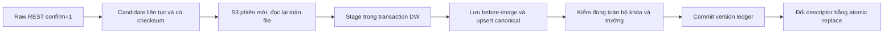

# Khôi phục dữ liệu canonical và xác nhận đóng nến

Bàn giao ngày 09/11/2026. Phiên: `20261109T063455Z-adb14c7395`.

## 1. Kết quả đã áp dụng

Đã xuất bản và kích hoạt snapshot **154,351 nến phút BTC-USDT**,
từ **2026-07-25T01:59:00+00:00 đến 2026-11-09T06:29:00+00:00** (UTC).
Snapshot có đủ lưới phút trong hai mốc, không trùng khóa, không có cờ đóng nến
NULL/False. Mọi nến đều có raw REST `confirm=1` tương ứng; không suy đoán đóng
nến từ tuổi dữ liệu và không nội suy/forward-fill giá để lấp khoảng thiếu.

Nguồn: [OKX Candlesticks history](https://www.okx.com/docs-v5/en/#order-book-trading-market-data-get-candlesticks-history); endpoint
`GET /api/v5/market/history-candles`, bar `1m`, tối đa 300 nến/trang.
Downloader dùng tối đa 4 worker, giới hạn chung 4 request/giây, retry hữu hạn.
`source_as_of=2026-11-09T06:34:55.261763+00:00` dùng để chốt điều kiện đủ tuổi;
mỗi trang vẫn có giờ thu nhận riêng, không coi nhiều request là một snapshot
transaction nguyên tử tại sàn.

| Chỉ tiêu | Trước | Sau |
|---|---:|---:|
| Gold được chọn | 129,613 nến | 154,351 nến, khoảng thời gian đã mở rộng |
| Phút thiếu giữa hai đầu Gold cũ | 105 | 0 |
| Cờ đóng nến chưa rõ ở các khóa lịch sử tương ứng | 129,599 | 0 trong snapshot mới |
| Dòng DW trong miền khôi phục đã chốt | 1,861 | 154,351 |
| Khóa canonical S3/DW cùng miền đối soát | 0 ở lựa chọn cũ khác miền thời gian | 154,351 |

Thêm **24,738 phút** so với Gold cũ, gồm 105 phút
trống trong miền cũ và phần mở rộng đến ngày chốt. Không diễn giải số dòng tăng
thành chất lượng dự báo cao hơn.

## 2. Nguồn raw và bằng chứng đóng nến

- Thu nhận **536 trang REST**, tổng 160,800 dòng trong các trang.
- Tách 6,449 dòng nằm ngoài biên từng chunk vì phân trang trả thêm lịch sử;
  đây không phải bản ghi lỗi bị làm sạch.
- Còn đúng **154,351 khóa phút trong miền cần khôi phục**, duy nhất
  và đều xác nhận đóng; duplicate xung đột/mất trang sẽ làm dừng quy trình.
- Từng nến lưu `provenance_run_id`, `source_page`, `source_page_sha256`,
  `source_fetched_at`. Có thể nối nến → raw row cùng timestamp → trang nguồn → SHA-256.
- File `closure_evidence_examples.csv` có 50 ví dụ. Bộ ZIP giữ raw và Parquet
  cùng manifest để kiểm tra lại; không chỉ có một bảng thống kê tự khai báo.
- OHLCV/doanh số phải hữu hạn, đúng geometry, UTC thẳng phút, độ dài 60 giây.
  Trade count, buy/sell volume, VWAP và imbalance giữ NULL theo hợp đồng parser
  REST hiện có, không tạo order flow giả.

## 3. Phiên bản S3 và cấu hình đang dùng

Gold đã kích hoạt:

`s3://duke-crypto-bigdata-863819358922-ap-southeast-1-an/crypto/canonical-repairs/20261109T063455Z-adb14c7395/gold/candles_1m`

Manifest:

`s3://duke-crypto-bigdata-863819358922-ap-southeast-1-an/crypto/canonical-repairs/20261109T063455Z-adb14c7395/manifest.json`

SHA-256 Gold: `50a2a30a67c4e8d5280a5d44334ed153f28320a15d481b7649e440947b205dd5`.

SHA-256 manifest: `38519d514e0b9966dce0cbc78fc37c431f228a7252f0857c71546f2d8f74375e`.

`configs/canonical_snapshot.json` là descriptor đang kích hoạt.
`storage.s3.get_gold_candles_path()` ưu tiên descriptor này khi đọc, bao gồm
đường đọc Gold của ML. Chế độ local đọc bản Parquet tương ứng trong
`data/canonical_repairs/`; S3 đọc URI theo cấu hình bucket và không âm thầm rơi
về Gold cũ khi descriptor sai.

**Gold cũ trong `crypto/gold/candles_1m` giữ làm archive**, không ghi đè/xóa.
Đã kiểm lại ETag của 4 file gốc.
Cờ NULL trong archive vẫn là trạng thái lịch sử, không phải dữ liệu active.
Kiểm kê lần sau chọn canonical qua descriptor để tránh báo nhầm archive là
phiên đang phục vụ.

Upload chỉ tạo object mới trong prefix riêng, dùng `If-None-Match: *` và
checksum; key đã tồn tại khác nội dung sẽ bị từ chối. Đây là bảo vệ của workflow,
không phải tuyên bố đã bật S3 Object Lock hoặc khóa phân tán toàn tổ chức.

Snapshot active được chặn ghi đè trực tiếp bởi batch Silver→Gold cũ. Muốn cập
nhật phải tạo phiên mới; lịch batch/versioning tự động vẫn là đầu việc riêng.
Nhánh streaming vẫn ghi Bronze/speed và DW theo quy tắc nguồn hiện có.

## 4. Đồng bộ DW có backup và transaction



Đã insert **152,490 khóa mới** và lưu before-image
của **1,861 dòng có sẵn** trong
`warehouse.canonical_repair_backups`. Metadata phiên nằm trong
`warehouse.canonical_dataset_versions`, gắn run ID với manifest SHA-256.
Trường `created_at` của DW là giờ insert/metadata, không thay cho giờ sự kiện.

Chỉ upsert khóa trong miền đã chốt. Không truncate, không delete dữ liệu nguồn,
không chạm các khóa live ngoài miền này. SQL dùng lại quy tắc REST ưu tiên
streaming; xác nhận thiếu/khác trường thì rollback transaction thay vì commit
bản nửa vời. Kiểm đối chiếu trước commit dùng staging có cùng kiểu NUMERIC,
so chính xác các trường tương ứng.

Đã thử chạy lại trên DB thật: **already_applied=True**, miền vẫn có đúng
154,351 khóa, version ledger chỉ một bản ghi; không insert trùng.
Nếu dữ liệu REST trong miền đã được một phiên mới sửa khác, retry phiên cũ sẽ
báo drift thay vì tự ghi đè dữ liệu mới hơn.

Nếu lỗi đổi pointer xảy ra sau commit DB, metadata và backup vẫn còn. Có thể
chạy lại cùng phiên để xác minh và hoàn tất pointer; tình huống này đã test trên
DB riêng. Đó là quy trình nhiều bước có resume, không tuyên bố có distributed
transaction giữa S3, PostgreSQL và filesystem.

## 5. Đối soát sau sửa

Tại **2026-11-09T07:02:11.325874+00:00**:

- S3 đọc ngược toàn bộ file Gold, SHA-256 khớp; manifest khớp descriptor.
- DW có đúng 154,351 khóa trong miền snapshot,
  tất cả `historical_rest`, `is_closed=True`, không cờ NULL, không khóa trùng.
- S3/DW chung 154,351 khóa,
  **0 khác biệt vượt độ chính xác lưu của DW** ở OHLCV/doanh số.
- 153,400 khóa khác cách biểu diễn
  doanh số do Double ↔ NUMERIC(24,4); được tách riêng, không gọi là mất dữ liệu.
- DW tổng thể có 154,382 dòng tại snapshot kiểm tra:
  phần ngoài miền là dữ liệu live khác thời điểm, nên không ép tổng bảng bằng
  số dòng của snapshot frozen.
- API health và nến DW 1m/1h/1d đều HTTP 200. Health có ID/bounds của
  canonical đang cấu hình; đây là metadata phiên, không phải kiểm tra S3 toàn
  file mỗi lần refresh.

Kiểm tra chỉ phủ trong **hai biên đã chốt**. Ngày/giờ ở biên có thể chưa đủ
trọn lịch (đầu nguồn bắt đầu 01:59 UTC; ngày hiện tại chưa kết thúc). Không
khẳng định mỗi ngày biên có đủ 1.440 phút, hoặc snapshot tự cập nhật đến giờ
hiện tại. Các tick/nến live sau `2026-11-09T06:29:00+00:00` vẫn là luồng riêng.

## 6. Kiểm thử và hồi quy

| Bộ kiểm tra | Kết quả |
|---|---:|
| Validation, phân trang/resume, immutable store, descriptor | 20/20 |
| Transaction, backup, rollback, idempotence trên PostgreSQL test riêng | 8/8 |
| Quy tắc reconciliation hiện có | 7/7 |
| Guard S3/test isolation, gồm pointer canonical active | 29/29 |
| Hồi quy web/API hiện có | 36/36 kiểm tra |
| **Tổng trong phạm vi này** | **100/100** |

Ngoài ra Spark đọc thực toàn bộ 154,351 dòng với Hive partition,
đếm đủ timestamp duy nhất và nhận đúng kiểu cột NULL. Log có cảnh báo dọn
scratch trên Windows sau khi Spark kết thúc; kiểm đọc/đếm đã thành công và kết
quả JSON lưu riêng. S3 được kiểm toàn file bằng read-back checksum riêng.

Các test ghi dữ liệu chỉ dùng DB test/thư mục owned hoặc MemoryS3. Không gọi
toàn bộ suite E2E Kafka→Spark→S3→DW trong lượt này. Không suy 100 kiểm tra trên
thành mọi test của repo, kiểm thử tải hay khả năng chạy bền đều đã hoàn thành.

## 7. Cách chạy và xác minh

```powershell
python scripts/run_canonical_repair.py --audit-run data/quality_audits/<audit-run>
python scripts/run_canonical_repair.py --resume data/canonical_repairs/<repair-run> --action build
# Chỉ promote sau khi xem candidate, kiểm continuity và các test liên quan:
python scripts/run_canonical_repair.py --resume data/canonical_repairs/<repair-run> --action promote
python -m unittest discover -s tests -p test_canonical_repair.py -v
python -m unittest discover -s tests -p test_canonical_repair_database.py -v
```

Audit/repair directory và `.env` không được commit. Descriptor và code có thể
review trong repo; bản dữ liệu S3/local dùng ID cố định. Giữ bộ raw và mã nguồn
đúng phiên nếu muốn tái lập. Để xem backup, chỉ đọc bảng backup theo `run_id`;
không tự chạy rollback ghi đè một phiên mới hơn.

## 8. Phần tiếp theo

Ưu tiên kế tiếp là đánh giá/cải thiện ML với phiên dữ liệu đã khóa và chia tập
theo thời gian. Phần này bổ sung nến phút cho bài toán ngắn hạn; **không huấn
luyện lại model và không đổi kết quả dự báo 36 tháng**. Đã đối chiếu model
artifacts và pointer forecast dài hạn giữ nguyên. Chưa có bằng chứng accuracy/
MAE tăng chỉ vì khôi phục dữ liệu; không bảo đảm điểm tuyệt đối.

Lịch cập nhật snapshot mới, vận hành batch Silver/Gold theo phiên bản, phục hồi
toàn hệ thống và chạy tải/lâu vẫn cần hoàn thành riêng theo kế hoạch.
