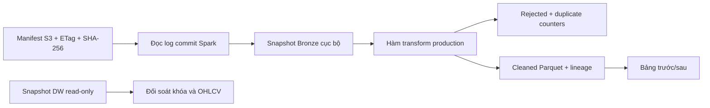

# Kiểm kê dữ liệu và thống kê trước/sau làm sạch

> Đây là snapshot kiểm kê **trước khi khôi phục canonical**. Kết quả sửa và phiên
> dữ liệu đang được chọn nằm trong [CANONICAL_DATA_REPAIR.md](CANONICAL_DATA_REPAIR.md).
> Các số liệu lịch sử bên dưới được giữ nguyên làm bằng chứng trước/sau.

Bàn giao ngày 09/11/2026. Run: `20261109T053821Z-fd5ae714`.
S3 được kiểm kê trong khoảng **2026-11-09T05:18:43.525888+00:00 → 2026-11-09T05:18:46.177362+00:00**.
PostgreSQL là snapshot riêng tại **2026-11-09T05:39:16.373504+00:00**. Tất cả các mốc bên dưới là UTC.

## 1. Kết quả chính

Đã kiểm kê object S3 hiện hữu, đếm dòng Parquet, đọc log commit Spark, kiểm tra dữ liệu
nghiệp vụ đã commit, kiểm kê file local và chụp PostgreSQL bằng transaction read-only/repeatable-read.
Đã chạy lại **hàm làm sạch production thật** trên nguồn Bronze cố định và đối chiếu lại
raw → daily → monthly của snapshot dự báo đã xuất bản. Không ghi/xóa S3 hoặc sửa DW.

- S3: **3,213 object**, **52,486,099 byte**; gồm cả checkpoint, staging và audit.
- Có **0 object sau cutoff** trong listing; không đưa nội dung các object đó vào snapshot phân tích.
- Gold dùng chung: **129,613 nến phút**, thiếu **105 phút** giữa hai đầu.
- Gold dùng chung có **129,599 dòng không rõ cờ đóng nến**; không được tự coi là nến đã đóng.
- DW hiện có **1,849 nến**; đây là dữ liệu khác phạm vi Gold dùng chung, không cộng hai nguồn thành một tập.
- Dữ liệu dài hạn: **3,224 → 3,223 nến ngày**, tổng hợp **105 tháng đầy đủ**.

Số liệu là bằng chứng tại thời điểm snapshot. Live tiếp tục chạy nên số dòng hiện tại có thể tăng.
Không phát hiện lỗi số học/OHLC trong phần được quét không đồng nghĩa dữ liệu đủ mọi thời điểm
hoặc đủ điều kiện huấn luyện. Các thiếu hụt và giới hạn được ghi riêng bên dưới.

Tần suất theo cấu hình: giao dịch đến liên tục, Spark trigger 10 giây, nến phút có bước 60 giây;
dữ liệu dài hạn dùng nến ngày UTC và tổng hợp tháng lịch. Đây là cadence cấu hình/độ hạt,
không chứng minh hệ thống đã thu nhận liên tục. Batch Silver/Gold của phiên chạy chưa có bằng chứng lịch tự động.

## 2. Kiểm kê S3 theo vai trò

| Vùng | Object | Byte | File Parquet |
|---|---:|---:|---:|
| active_run | 1,137 | 6,500,831 | 923 |
| checkpoint | 1,828 | 239,113 | 0 |
| forecast_snapshot | 8 | 832,995 | 2 |
| model | 5 | 60,112 | 0 |
| shared | 198 | 7,930,459 | 88 |
| staging | 25 | 36,761,990 | 20 |
| test_or_audit | 12 | 160,599 | 2 |

`shared`: dữ liệu dùng chung; `active_run`: prefix phiên chạy đang cấu hình;
`staging`: bản trung gian; `test_or_audit`: kiểm thử cũ; `checkpoint`: trạng thái Spark;
`forecast_snapshot`: snapshot dự báo; `model`: artifact model. Không cộng lẫn các vai trò.

| Dataset | Vai trò | Dòng vật lý | Dòng đã commit/listing | File chưa được log ghi nhận |
|---|---|---:|---:|---:|
| `crypto/bronze/trades` | shared | 128 | 128 | 0 |
| `crypto/gold/candles_1m` | shared | 129,613 | 129,613 | 0 |
| `crypto/gold/candles_1m_staging_1793518824414_280b71` | staging | 129,613 | 129,613 | 0 |
| `crypto/gold/candles_1m_staging_1793597877092_3d0cc3` | staging | 129,613 | 129,613 | 0 |
| `crypto/gold/candles_1m_staging_1793845951299_82ccfa` | staging | 129,613 | 129,613 | 0 |
| `crypto/gold/candles_1m_staging_1793858189569_e41f20` | staging | 129,613 | 129,613 | 0 |
| `crypto/gold/candles_1m_staging_1793928500467_37c8be` | staging | 129,613 | 129,613 | 0 |
| `crypto/local-runs/codex-20261106T032328Z/audit/20261106T034251Z` | test_or_audit | 181 | 181 | 0 |
| `crypto/local-runs/codex-20261106T032328Z/audit/20261106T034402Z` | test_or_audit | 181 | 181 | 0 |
| `crypto/local-runs/codex-20261106T032328Z/bronze/trades` | active_run | 15,092 | 15,073 | 1 |
| `crypto/local-runs/codex-20261106T032328Z/long_term/20261108T142006113873Z` | forecast_snapshot | 3,328 | 3,328 | 0 |
| `crypto/local-runs/codex-20261106T032328Z/speed/candles_1m` | active_run | 142 | 142 | 0 |
| `crypto/silver/trades` | shared | 128 | 128 | 0 |
| `crypto/streaming/candles_1m` | shared | 84 | 81 | 3 |
| `crypto/streaming/trades` | shared | 2 | 2 | 0 |

Các dataset có `_spark_metadata` dùng compact log mới nhất và các batch nối tiếp
để xác định file đã commit. File không có trong log có thể chưa commit tại mốc snapshot
hoặc là file thừa; **không tự gọi là dữ liệu hỏng và không tự xóa**. Dataset không có log
được đánh dấu `directory_listing`; `_SUCCESS` một mình không chứng minh toàn bộ lịch sử xử lý.

Staging chỉ kiểm footer/count/checksum; không đánh đồng với dữ liệu production đã publish.
`same_parquet_bytes_as` trong JSON chỉ ra tập file có cùng byte/checksum; đây không phải
lý do cộng thêm dữ liệu. Inventory chỉ xét phiên bản object hiện tại, không gồm version cũ.

## 3. Bảng trước/sau làm sạch có thể đưa vào báo cáo

| Nguồn cố định | Trước | Loại không hợp lệ/chưa đóng | Loại trùng | Sau |
|---|---:|---:|---:|---:|
| `crypto/bronze/trades` | 128 | 0 | 0 | 128 |
| `crypto/local-runs/codex-20261106T032328Z/bronze/trades` | 15,073 | 0 | 0 | 15,073 |
| `OKX daily / 20261108T142006113873Z` | 3,224 | 1 | 0 | 3,223 |

Phép đối chiếu: **Trước = Loại không hợp lệ + Loại trùng + Sau**. Lý do lỗi
chi tiết có hai dạng: `primary` mỗi dòng chỉ tính một lần; `overlapping` cho biết tất cả
lỗi của dòng đó nên không được cộng thành tổng dòng lỗi.

Dữ liệu thật không có lỗi/trùng theo các quy tắc này thì ghi đúng là 0; không chèn
dòng lỗi giả để làm đẹp bảng. Khả năng bắt lỗi được kiểm thử riêng bằng fixture synthetic.
Đối với Gold lịch sử 129.613 nến: đây là profile đầu ra đang lưu. Chưa có bằng chứng raw cùng
phiên bao phủ toàn bộ tập này để tái lập số dòng từng bị loại; không được suy ngược rejected=0
chỉ vì đầu ra hiện không phát hiện giá/OHLC sai.

### `crypto/bronze/trades`

- Khoảng event time: 2026-10-23 01:46:19.368000 → 2026-10-23 03:56:35.031000 UTC.
- Mã giao dịch xung đột: 0; trường hợp không đủ khóa phân thắng khi dedup: 0.
- Lỗi giá trị doanh số phát sinh sau tính toán: 0.
- Silver lưu sẵn: 128 dòng; khớp 128 trade_id,
  khác giá trị trên 0 trade_id trong các trường đã đối chiếu.

### `crypto/local-runs/codex-20261106T032328Z/bronze/trades`

- Khoảng event time: 2026-11-06 03:26:22.146000 → 2026-11-09 05:18:30.068000 UTC.
- Mã giao dịch xung đột: 0; trường hợp không đủ khóa phân thắng khi dedup: 0.
- Lỗi giá trị doanh số phát sinh sau tính toán: 0.
- **Chưa có Silver đã publish trong prefix này.** Sau làm sạch ở bảng trên là replay local có lưu
  input/output Parquet và lineage, không phải tuyên bố batch Silver/Gold đang tự động chạy trên S3.

### Dữ liệu dự báo dài hạn

Run gốc `20261108T142006113873Z`; source as_of **2026-11-08T14:12:31.162083+00:00**.
Phạm vi nến ngày: **2018-01-11 → 2026-11-07**; thiếu 0 ngày
giữa hai đầu; không nội suy. Replay dùng giờ chốt của nguồn, không dùng giờ hiện tại để đổi kết quả cũ.
Có một nến chưa đóng được loại. Hai tháng biên chưa đủ ngày được loại khỏi **tổng hợp tháng**:
- 2018-01: có 21/31 ngày.
- 2026-11: có 7/30 ngày.

Từ nến ngày sang tháng là phép tổng hợp, không phải hàng nghìn dòng bị mất do làm sạch.
Daily/monthly tái tạo khớp snapshot đã publish; hai file Parquet trên S3 được đối chiếu SHA-256 với local.
Mốc nguồn cũ không tự trở thành dữ liệu cập nhật đến ngày kiểm kê; chưa tải thêm ngày mới trong đầu việc này.

## 4. Chất lượng và khoảng thiếu

| Nguồn nến | Dòng | OHLC/thời gian/kiểu số sai | Trùng timestamp | Phút thiếu giữa hai đầu | Cờ đóng nến NULL |
|---|---:|---:|---:|---:|---:|
| `crypto/gold/candles_1m` | 129,613 | 0 | 0 | 105 | 129599 |
| `crypto/local-runs/codex-20261106T032328Z/speed/candles_1m` | 142 | 0 | 0 | 4,288 | 0 |
| `crypto/streaming/candles_1m` | 81 | 0 | 0 | 2,479 | 0 |
| PostgreSQL BTC-USDT | 1,849 | 0 | 0 | 4,086 | 0 |

Phút thiếu = số ô phút UTC mong đợi giữa min/max trừ số timestamp hợp lệ duy nhất.
Đó không phải tỷ lệ API hoạt động hay phần trăm toàn thị trường đã thu thập. Với dữ liệu
trade, phút không quan sát được giao dịch có thể do không thu nhận hoặc không có giao dịch;
không suy diễn rằng toàn sàn không giao dịch. Không tạo nến giả bằng forward-fill.

Trong 24 giờ đã kết thúc ở mốc DW: có **331/1440**
timestamp phút, thiếu **1109**; đây là hiện diện timestamp,
chưa khẳng định mọi nến đều finalized. Có **1 nến chưa đóng**, trong đó
**0** nến đã cũ hơn 5 phút mà chưa đóng.

NULL ở trade_count/buy_volume/sell_volume của REST là thông tin không được nguồn cung cấp,
không phải tự động là bản ghi sai. Ngược lại, NULL ở is_closed nghĩa là thiếu bằng chứng xác nhận
hoàn tất; cần đối soát nguồn trước khi đưa vào bộ huấn luyện yêu cầu nến đã đóng.

## 5. PostgreSQL và đối soát

| Bảng | Dòng | Dung lượng bảng + index (byte) | Min / Max sự kiện UTC |
|---|---:|---:|---|
| `fact_crypto_1m_candles` | 1849 | 851968 | 2026-11-05T02:44:00+00:00 / 2026-11-09T05:38:00+00:00 |
| `fact_crypto_trades` | 22 | 122880 | 2026-11-06T03:17:30.290000+00:00 / 2026-11-09T05:31:04.053000+00:00 |
| `fact_btc_predictions` | 211 | 147456 | 2026-11-06T02:39:00+00:00 / 2026-11-09T05:37:00+00:00 |
| `fact_btc_model_evaluation` | 0 | 16384 | — / — |

Dung lượng `pg_total_relation_size` gồm index/TOAST và không thể so trực tiếp với file Parquet nén.
`fact_crypto_trades` trong nhánh streaming chỉ nhận giao dịch lớn ≥100.000 USDT, không phải
mọi giao dịch Bronze. Chênh lệch số dòng giữa hai bảng không được gọi là tỷ lệ mất dữ liệu.

| Lake → DW | Khóa chung | Khác vượt độ chính xác DW | Chỉ khác do làm tròn | Chỉ có ở lake | Chỉ có ở DW |
|---|---:|---:|---:|---:|---:|
| `crypto/gold/candles_1m` | 0 | 0 | 0 | 129613 | 1849 |
| `crypto/local-runs/codex-20261106T032328Z/speed/candles_1m` | 142 | 5 | 136 | 0 | 1707 |
| `crypto/streaming/candles_1m` | 0 | 0 | 0 | 81 | 1849 |

Chỉ đối chiếu cùng `(symbol, window_start)`. Đọc numeric_scale trực tiếp từ schema DW tại snapshot;
dung sai là nửa đơn vị lưu trữ NUMERIC cộng 4 ULP do số thực. Doanh số DW scale=4, không so nó
như float chính xác vô hạn. JSON vẫn giữ cả số khác ở độ chính xác thô và số chỉ lệch do làm tròn.
Không có khóa chung thì **chưa đủ bằng chứng đồng bộ**. Khác nhau có thể do thời điểm chụp,
REST canonical cập nhật lại nến hoặc streaming còn thiếu giao dịch; audit không tự ghi đè để ép khớp.

## 6. Quy tắc làm sạch và khả năng truy vết



Trade được giữ khi có trade_id, đúng BTC-USDT, price/size hữu hạn >0, timestamp >0 và side buy/sell.
Khử trùng trade_id theo raw_timestamp mới nhất rồi Kafka offset cao nhất. Audit ghi nhận cả trường hợp
khóa sắp xếp còn hòa mà giá trị xung đột; không tự tuyên bố lựa chọn là duy nhất nếu thiếu khóa phân thắng.
Thời gian được chuẩn hóa UTC. Đây là các quy tắc hiện có, không phải bằng chứng rằng mọi lỗi ngữ nghĩa đều bị chặn.

Mỗi dòng replay giữ `_source_object`, `_source_sha256`, trade_id và Kafka partition/offset khi có.
Có thể nối kết quả → dòng nguồn → object → SHA-256 → run audit → phiên bản code/config.
Lineage mới này **không khôi phục lịch sử phiên thu thập/ETL đã thiếu cho mọi bản ghi cũ**.
Quarantine đã lưu **trong audit local**; batch production trước đó chỉ đếm/loại lỗi và chưa có
quarantine bền vững trên S3 kèm manifest cho từng phiên. Chưa thiết lập lịch Silver/Gold trong đầu việc này.

## 7. Các việc còn phải xử lý từ bằng chứng này

1. Đối soát/backfill các khoảng nến phút thiếu bằng REST; chỉ cập nhật nguồn chuẩn sau khi kiểm geometry,
   xác nhận đóng nến và quy tắc canonical. Không lấp số liệu bằng nến giả.
2. Xác minh cờ đóng nến bị NULL trong Gold lịch sử từ nguồn raw/REST; không đổi hàng loạt NULL thành True.
3. Xuất bản Silver/Gold cho phiên chạy sau khi replay đã kiểm chứng; bổ sung manifest, quarantine bền vững,
   lịch batch và trạng thái từng phiên. Hoàn thành riêng đầu việc vận hành này.
4. Xác định tập nến canonical thống nhất giữa S3 và DW; báo cáo miền thời gian khác nhau trước khi so số dòng.
5. Sau khi khóa phiên bản dữ liệu phù hợp, tiếp tục đánh giá ML nhiều giai đoạn; kiểm kê/làm sạch tốt
   không tự làm MAE/accuracy tốt hơn và không bảo đảm điểm tuyệt đối.

## 8. Tái lập và giới hạn

```powershell
python scripts/run_data_quality_audit.py --snapshot-only
python scripts/run_data_quality_audit.py --from-snapshot data/quality_audits/<snapshot-run>
python scripts/render_data_quality_report.py --run data/quality_audits/<completed-run> --output <report-directory>
python -m unittest discover -s tests -p test_data_quality_audit.py -v
python -m unittest discover -s tests -p test_quality_trade_replay.py -v
```

Cần Python/Arrow/Pandas, Spark/Java và cấu hình S3/PostgreSQL hiện có; không đưa secret vào báo cáo.
Lần chạy mới có ID riêng; khi reuse snapshot sẽ kiểm lại SHA-256 từng file. GET có IfMatch ETag,
nhưng ETag không được coi là SHA-256. S3 listing nhiều object không phải snapshot transaction nguyên tử;
các file được cố định theo manifest/cutoff và kiểm trước khi đọc. DB là snapshot ở thời điểm riêng.
Không quét version S3 cũ. Local inventory không cộng các file sinh ra của chính audit/checkpoint vào dữ liệu nguồn.
Bản inventory và replay này không xuất bản lại model, không sửa dữ liệu nguồn, không hoàn thành các đầu việc ML/batch tiếp theo.

## 9. File bàn giao để dùng khi viết báo cáo

- `Thong-ke-truoc-sau-lam-sach.csv`: bảng số dòng và phép cân bằng trước/sau.
- `Kiem-ke-dataset-S3.csv`, `Kiem-ke-object-S3.csv`, `Kiem-ke-file-local.csv`: quy mô, vị trí và checksum.
- `Cac-khoang-thieu-nen.csv`: đầy đủ các khoảng thiếu trong phạm vi đã kiểm tra.
- `Tu-dien-du-lieu.csv`: ý nghĩa trường, đơn vị BTC/USDT và quy tắc sử dụng NULL.
- `Ket-qua-kiem-ke-va-lam-sach.json`: toàn bộ số đo, nguồn/config hash và thời điểm snapshot.
- Bộ ZIP minh chứng: mã nguồn, log test, input/output replay, ví dụ lineage và nến loại ở nguồn ngày.
